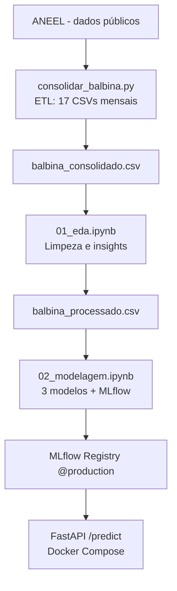
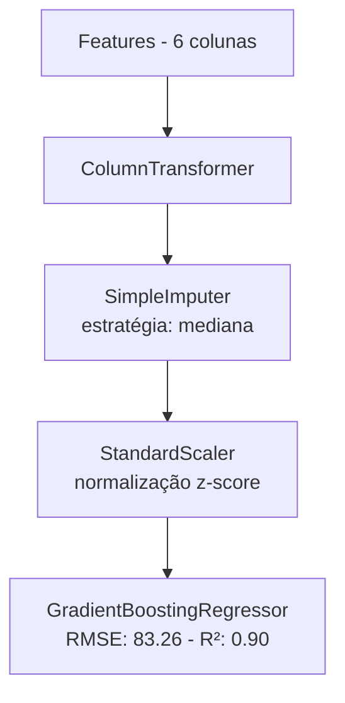

# Balbina Hydro MLOps

Projeto de machine learning para previsão de vazão defluente da UHE Balbina (AM),
desenvolvido como Desafio 01 da disciplina de Data Science, Machine Learning e Data Mining
do curso de Digital Transformation - IFAM / AxAcademy.

## Problema

A Usina Hidrelétrica de Balbina opera no rio Uatumã, no Amazonas. A ideia desse projeto
é prever a vazão defluente horária da usina com base em variáveis hidrológicas coletadas
pela ANEEL, ajudando operadores a antecipar a capacidade de geração de energia.

- Tipo de problema: Regressão
- Variável-alvo: `val_vazaodefluente` (m³/s)
- Modelo vencedor: GradientBoostingRegressor (RMSE CV: 83.26 | R²: 0.90)

## Dataset

Os dados foram coletados do portal de dados abertos da ANEEL:
https://dadosabertos.aneel.gov.br

Período: janeiro/2025 a maio/2026 (17 meses, dados horários)
Total após limpeza: 12.077 registros

O script `consolidar_balbina.py` automatiza a leitura dos 17 arquivos mensais,
filtra apenas os registros de Balbina e gera o dataset consolidado.

## Como o dataset foi construído

Os dados hidrológicos da ANEEL são disponibilizados mensalmente no portal de dados abertos.
Cada arquivo mensal contém registros horários de diversas usinas do Brasil.

O script `consolidar_balbina.py` realiza as seguintes etapas automaticamente:

1. Lê todos os CSVs mensais da pasta `data/raw/mensais/`
2. Filtra apenas os registros da UHE Balbina (`nom_reservatorio == 'BALBINA'`)
3. Corrige o encoding latin-1 dos arquivos originais para utf-8
4. Converte as colunas numéricas e a coluna de data para os tipos corretos
5. Adiciona colunas auxiliares de ano, mês, dia e hora
6. Remove duplicatas geradas pela sobreposição entre arquivos mensais
7. Salva o dataset consolidado em `data/raw/balbina_consolidado.csv`

Para reproduzir a consolidação:

```bash
python consolidar_balbina.py
```

## Arquitetura

O projeto segue o ciclo CRISP-DM completo, do dado bruto até o endpoint em produção.

### Fluxo da arquitetura



### Pipeline do modelo



**Stack utilizada:**
- `scikit-learn` - Pipeline, ColumnTransformer, modelos de regressão
- `MLflow` - rastreamento de experimentos e Model Registry
- `DVC` - versionamento de datasets e mlruns
- `FastAPI` + `uvicorn` - servidor da API
- `Docker Compose` - containerização

## Estrutura

```
.
├── data/
│   ├── raw/
│   │   ├── mensais/                   # CSVs mensais originais da ANEEL
│   │   └── balbina_consolidado.csv.dvc
│   └── processed/
│       └── balbina_processado.csv.dvc
├── notebooks/
│   ├── 01_eda.ipynb                   # Análise exploratória
│   ├── 01_eda.pdf
│   ├── 02_modelagem.ipynb             # Treinamento e MLflow
│   └── 02_modelagem.pdf
├── screenshots/                       # Screenshots MLflow e Swagger
├── src/
│   ├── api.py                         # FastAPI
│   ├── promover.py                    # Promove modelo para @production
│   └── treino.py                      # Referência ao notebook de treino
├── mlruns/                            # MLflow Tracking local (versionado no DVC)
├── consolidar_balbina.py              # ETL dos CSVs mensais
├── montar_zip.py                      # Script para empacotar entrega
├── mlruns.dvc                         # MLflow versionado no DVC
├── Dockerfile
├── docker-compose.yml
├── requirements.txt
├── requirements-api.txt
└── README.md
```

## Pré-requisitos

- Python 3.11+
- Docker Desktop
- Git e DVC

## Como reproduzir

### 1. Clonar

```bash
git clone https://github.com/vbrenox/Balbina-Hydro-mlops.git
cd Balbina-Hydro-mlops
```

### 2. Ambiente virtual

```bash
python -m venv venv
venv\Scripts\activate
pip install -r requirements.txt
```

### 3. Recuperar datasets e mlruns via DVC

```bash
dvc pull
```

### 4. Treinar os modelos

Abra o Jupyter e execute os notebooks em ordem:

```bash
jupyter notebook
```

- `notebooks/01_eda.ipynb` - análise exploratória
- `notebooks/02_modelagem.ipynb` - treinamento e registro no MLflow

### 5. Subir a API

```bash
docker compose up --build
```

Acesse: `http://localhost:8000/docs`

### 6. Subir o MLflow UI (opcional)

```bash
mlflow ui --backend-store-uri ./mlruns --port 5002
```

Acesse: `http://localhost:5002`

## Comparativo dos modelos

| Modelo | RMSE CV | R² CV | RMSE Teste | R² Teste |
|---|---|---|---|---|
| LinearRegression | 107.74 | 0.817 | 182.34 | 0.764 |
| RandomForestRegressor | 90.05 | 0.893 | 162.98 | 0.812 |
| **GradientBoostingRegressor** | **83.26** | **0.904** | **160.96** | **0.816** |

## Decisões de modelagem

- `val_vazaoturbinada` removida por data leakage (r=1.00 com o alvo)
- `val_volumeutil` removida por multicolinearidade (r=0.99 com `val_nivelmontante`)
- `val_vazaooutrasestruturas` e `val_vazaotransferida` removidas por ~95% de nulos
- `val_vazaovertida` e `val_vazaovertidanaoturbinavel` removidas por serem quase constantes
- Pré-processamento via Pipeline + ColumnTransformer com StandardScaler e SimpleImputer

## Soluções técnicas

- Detecção automática de ambiente Docker vs local via `/.dockerenv`
- Busca automática do modelo mais recente na pasta `models/` do MLflow 3.x
- Caminho universal para MLflow via `os.path.abspath`
- Correção de encoding latin-1 para utf-8 nos dados da ANEEL
- Filtro tolerante a espaços invisíveis nos dados brutos da ANEEL
- Script `montar_zip.py` para empacotar a entrega excluindo pastas pesadas

## Limitações

- Histórico de 17 meses pode limitar a generalização do modelo
- Eventos extremos de cheia são difíceis de capturar
- Próximo passo: integração com coleta automatizada via RPA e detecção de anomalias

## Aviso

> **Propriedade Intelectual:** Este projeto e todo o seu código-fonte, automações e artefatos são de propriedade da LG Electronics do Brasil Ltda., desenvolvido no âmbito do projeto AX Academy - Digital Transformation (Convênio N.º 005/2025 - INOVA / IFAM). Consulte o arquivo LICENSE para mais detalhes.
